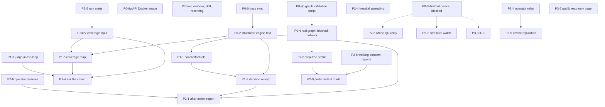

# DEPENDENCY_MAP.md: what must come first

Owner: lead agent.

| Arrow style | Meaning |
| --- | --- |
| Solid arrow | A hard dependency: the later item cannot be built or tested correctly without the earlier one |
| Dotted arrow | A soft dependency: the later item works without the earlier one, but needs it for an honest device or real-map demo |

Task-level detail is in docs/TASKS.md.

## Shared foundations

| Foundation | Used by | Why it comes first |
| --- | --- | --- |
| **Structured engine text** (P0-2) | P1-1, P1-2, P1-5, P2-1 and every new sentence | Each new sentence is written once, in the catalog, in three languages. Retrofitting later would mean translating twice |
| **F-COV, coverage input** | P1-5, P1-4, and P2-5 (alerts feed the same rule) | The engine needs the time of the latest observation on each edge, Road clear reports included. Without it, a "No, not flooded" answer could not affect anything, and the map could not tell "no reports" from "reports say clear" |
| **`/history` and seq** (exists) | P1-2, P2-1 | Replaying a past snapshot needs `incidentsAtSeq` (exists, tested) |
| **Normal report path** (exists) | P1-3, P1-4, P2-2 | All new evidence enters through `ReportsService` so corroboration, snapping, rate limits and seq stay in one place |
| **Operator action path** (exists) | P1-3 bulk clear, P2-6, P2-4 | One guard, one event log |

## Integration gates

- **After P0-2:**
  - parity hash unchanged;
  - the demo replay's plan hashes unchanged;
  - both clients render every engine key in en, hi and mr.
- **After F-COV:**
  - replay the demo and record any decision difference;
  - re-tune only if a scripted step changes, and log it in docs/scoring.md.
- **After P1-3:** a two-browser Playwright run against the real API (report, then corroborate, verify, and route change).
- **G-P1:** the seven-point check in IMPLEMENTATION_PLAN §9.

## Not safe in parallel

| Pair | Reason |
| --- | --- |
| P0-2 and any new engine sentence (P1-1, P1-2) | Both edit `explain.ts` and the text catalog |
| F-COV and P1-4 or P1-5 | Contract, API and engine input change underneath them |
| P1-1 and P1-2 | The receipt hashes the plan output, including the new counterfactual field |
| P2-3 and P2-4 | Both extend `Profile` or `planTrip` inputs and the parity cases |
| P2-9 and P2-3 or P2-4 | P2-9 adds a plan input (`preferLit`) and parity cases in the same places |
| P2-8 and any other contracts change | P2-8 adds an incident type and a field to `Incident` |
| Anything that touches `packages/contracts` | One contracts change at a time; CONTRACTS.md updated in the same commit |

## Safe in parallel

These can run alongside other work, by separate agents with clear folder ownership:
- P0-6a (Docker), P0-5 (docs and recording) and P0-4p (script) alongside P0-2;
- P2-5 adapter work (API-only) alongside a console-only feature;
- P3-7 (console-only) alongside any engine or mobile feature.
